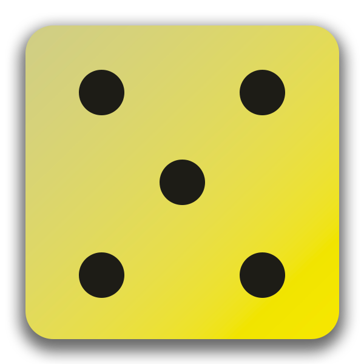
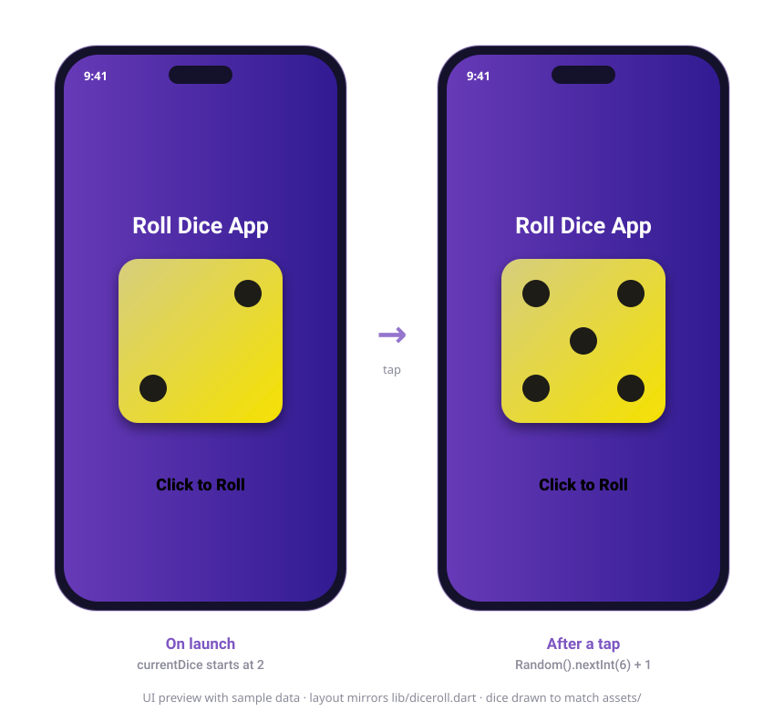
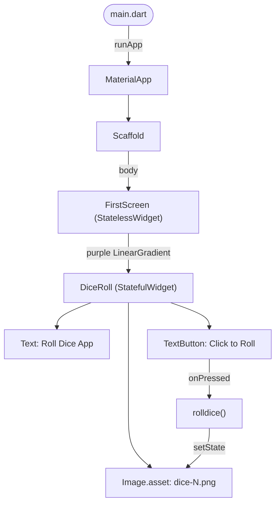
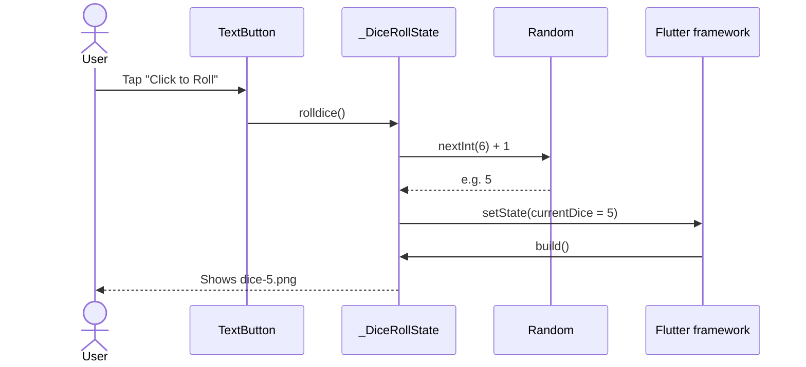

<div align="center">



<br><br>



# Roll Dice

**One tap. One random number. One clean Flutter widget tree.**

A small Flutter app that rolls a six-sided die every time you tap the button. Built to practise the core of Flutter: stateless vs stateful widgets, `setState`, local image assets and a gradient UI, with a GitHub Actions pipeline that builds it for the web.

<br>


[Features](#-features) · [Preview](#-preview) · [How it works](#-how-it-works) · [Getting started](#-getting-started) · [Structure](#-project-structure) · [Roadmap](#-roadmap)

</div>

---

## ✨ Features

<table>
<tr>
<td width="50%" valign="top">

### 🎲 Fair 1–6 rolls
Every tap calls `Random().nextInt(6) + 1`, so each face has an equal chance.

</td>
<td width="50%" valign="top">

### ⚡ Instant UI update
`setState` swaps the die image the moment you tap. No packages, no boilerplate.

</td>
</tr>
<tr>
<td width="50%" valign="top">

### 🎨 Polished look
Deep-purple gradient background with crisp 600×600 dice artwork, centred and scaled to 300px.

</td>
<td width="50%" valign="top">

### 🚀 CI web build
A GitHub Actions workflow builds a release web bundle on every push to `main` and deploys it to GitHub Pages.

</td>
</tr>
</table>

---

## 📱 Preview

<div align="center">


<sub>UI preview with sample data. The layout mirrors <code>lib/diceroll.dart</code>; the dice are drawn to match the real assets.</sub>
</div>

<!--
Real screenshots / demo GIF go here:

| Launch | After a roll | Web |
|:---:|:---:|:---:|
|  |  |  |
-->

---

## 🧠 How it works

### Widget tree



### One roll, step by step



### Engineering decisions

| Decision | Why it matters |
|---|---|
| State lives only in `DiceRoll` | `FirstScreen` stays a `StatelessWidget`, so only the part that changes rebuilds. |
| One shared `Random()` instance | Created once at file level instead of on every tap. |
| Asset path built from the number (`dice-$currentDice.png`) | No `switch` or `if` chain; six faces map directly to six files. |
| Whole folder declared in `pubspec.yaml` | Adding or replacing dice art needs no code changes. |
| Web build in CI with `--base-href "/<repo>/"` | The build works under a GitHub Pages sub-path without hard-coding the repo name. |

---

## 🛠 Tech stack

| Layer | Tool |
|---|---|
| Framework | [Flutter](https://flutter.dev) (stable) |
| Language | [Dart 3](https://dart.dev) (`sdk: ^3.12.2`) |
| UI | Material widgets |
| Icons | [cupertino_icons](https://pub.dev/packages/cupertino_icons) |
| Linting | [flutter_lints](https://pub.dev/packages/flutter_lints) |
| CI/CD | GitHub Actions with [subosito/flutter-action](https://github.com/subosito/flutter-action) → GitHub Pages |

---

## 🚀 Getting started

**Prerequisites:** [Flutter SDK](https://docs.flutter.dev/get-started/install) (stable channel, Dart 3.12+), plus an emulator, a device or Chrome.

```bash
# 1. Clone
git clone https://github.com/RafayAijaz/Roll-Dice.git
cd Roll-Dice

# 2. Install dependencies
flutter pub get

# 3. Run (pick a device, or force one)
flutter run
flutter run -d chrome   # web
```

Build a release web bundle the same way CI does:

```bash
flutter build web --release --base-href "/Roll-Dice/"
```

> [!TIP]
> No API keys or `.env` needed. If the dice images don't show, stop the app and run it again: new assets are only picked up after a full restart, not a hot reload. Still blank? `flutter clean && flutter pub get`.

---

## 🧪 Tests

`test/widget_test.dart` is an empty placeholder, so there are no automated tests yet. Planned widget tests:

| Test | What it checks |
|---|---|
| Renders on launch | Title, a die image and the **Click to Roll** button are on screen. |
| Starts on 2 | The first image is `dice-2.png`. |
| Roll stays in range | After many taps, every face shown is between 1 and 6. |

```bash
flutter test
```

---

## 📂 Project structure

```text
Roll-Dice/
├── lib/
│   ├── main.dart                # Entry point: MaterialApp + Scaffold
│   ├── firstscreen.dart         # Gradient background container
│   └── diceroll.dart            # Stateful die: image, button, roll logic
├── assets/images/dice-images/
│   └── dice-1.png … dice-6.png  # One image per face
├── test/
│   └── widget_test.dart         # Placeholder for widget tests
├── docs/assets/                 # README banner and preview
├── .github/workflows/
│   └── deploy.yml               # Build Flutter web and deploy to Pages
├── pubspec.yaml                 # Dependencies and asset registration
└── android/ ios/ web/ linux/ macos/ windows/   # Generated platform runners
```

---

## 🗺 Roadmap

- [x] Roll a fair six-sided die with `setState`
- [x] Gradient UI with local image assets
- [x] CI web build on every push
- [ ] Live web demo on GitHub Pages
- [ ] Write the widget tests listed above
- [ ] Add `flutter analyze` + `flutter test` to CI before deploy
- [ ] Roll animation (spin and bounce) and haptic feedback
- [ ] Bundle the Rubik font (referenced in code but not shipped yet)
- [ ] Roll two dice and show the total
- [ ] Custom app icon and a real `pubspec` description

---

## 📜 Commit history

```text
22db9b0  Initial commit: Roll Dice Flutter app
```

---

## 🙏 Acknowledgements

- [Flutter docs](https://docs.flutter.dev) and the Flutter community.
- Dice artwork in `assets/images/dice-images/`.

---

<div align="center">

### 👤 Author

**Muhammad Rafay Aijaz**
Flutter developer · Cybersecurity student

[](https://github.com/RafayAijaz)

If this helped you learn something, please ⭐ the repo!

</div>
